<picture><source media="(prefers-color-scheme: dark)" srcset="edition/hero-skyline-dark.svg"></picture>

I build AI agents that talk to real systems, data pipelines that hold up, and small things that are fun to use. I’m finishing an M.Eng. in Applied Data Science at the University of Victoria (December 2026). Off the clock: F1 every race weekend, speedcubing, and a serious banana bread.

🌐 [Portfolio](https://tgoyal.me) · ✍️ [Blog](https://tejalgoyal2.github.io) · 💼 [LinkedIn](https://www.linkedin.com/in/tejalgoyal) · 📄 [Resume](https://tgoyal.me/resume.pdf)

## Projects

<table>
<tr>
<td width="176" valign="top"><a href="https://github.com/tejalgoyal2/portfolio"><picture><source media="(prefers-color-scheme: dark)" srcset="edition/thumb-portfolio-dark.svg"></picture></a></td>
<td valign="top"><b><a href="https://github.com/tejalgoyal2/portfolio">tgoyal.me</a></b> My personal site, set like a newspaper. It reads like one right up until you touch it. JavaScript · ★ 1 · updated 1d ago</td>
</tr>
<tr>
<td width="176" valign="top"><a href="https://github.com/tejalgoyal2/Dime"><picture><source media="(prefers-color-scheme: dark)" srcset="edition/thumb-dime-dark.svg"></picture></a></td>
<td valign="top"><b><a href="https://github.com/tejalgoyal2/Dime">dime</a></b> An expense tracker you text like a friend. It reads plain English (and Hinglish), files it, and has opinions. TypeScript · ★ 1 · updated 5d ago</td>
</tr>
<tr>
<td width="176" valign="top"><a href="https://github.com/tejalgoyal2/type"><picture><source media="(prefers-color-scheme: dark)" srcset="edition/thumb-type-dark.svg"></picture></a></td>
<td valign="top"><b><a href="https://github.com/tejalgoyal2/type">type</a></b> A blank page for typing, just for the feel of it. No timer and no score: letters land with weight, the page has mass, and six styles answer your rhythm. TypeScript · updated 3w ago</td>
</tr>
<tr>
<td width="176" valign="top"><a href="https://github.com/tejalgoyal2/bide"><picture><source media="(prefers-color-scheme: dark)" srcset="edition/thumb-bide-dark.svg"></picture></a></td>
<td valign="top"><b><a href="https://github.com/tejalgoyal2/bide">bide</a></b> A living map of Victoria, BC: every bus moving now, with light that follows the real sun, weather and tide, and an honest scoreboard of arrival predictions. JavaScript · updated today</td>
</tr>
<tr>
<td width="176" valign="top"><a href="https://github.com/tejalgoyal2/iam-threat-mapper"><picture><source media="(prefers-color-scheme: dark)" srcset="edition/thumb-iam-threat-mapper-dark.svg"></picture></a></td>
<td valign="top"><b><a href="https://github.com/tejalgoyal2/iam-threat-mapper">IAM Threat Mapper</a></b> Five real breaches, taken apart one login at a time and mapped to the attacker’s playbook, MITRE ATT&amp;CK. JavaScript · ★ 2 · updated Mar 2026</td>
</tr>
<tr>
<td width="176" valign="top"><a href="https://github.com/tejalgoyal2/claubi"><picture><source media="(prefers-color-scheme: dark)" srcset="edition/thumb-claubi-dark.svg"></picture></a></td>
<td valign="top"><b><a href="https://github.com/tejalgoyal2/claubi">claubi</a></b> A coding agent in Rust that lives on your own machine, treats AI-written code as untrusted, and asks before it acts. Rust · ★ 2 · updated Apr 2026</td>
</tr>
<tr>
<td width="176" valign="top"><a href="https://github.com/tejalgoyal2/wiki"><picture><source media="(prefers-color-scheme: dark)" srcset="edition/thumb-wiki-dark.svg"></picture></a></td>
<td valign="top"><b><a href="https://github.com/tejalgoyal2/wiki">wiki</a></b> A growing, linked wiki of software, data and ML. One deep lesson a day. TypeScript · updated today</td>
</tr>
<tr>
<td width="176" valign="top"><a href="https://github.com/tejalgoyal2/sudoku-app"><picture><source media="(prefers-color-scheme: dark)" srcset="edition/thumb-sudoku-app-dark.svg"></picture></a></td>
<td valign="top"><b><a href="https://github.com/tejalgoyal2/sudoku-app">sudoku</a></b> A calm, ad-free Sudoku for phone and laptop: daily puzzle, hints that teach, challenges, 11 themes, offline. Built out of pure spite. JavaScript · updated today</td>
</tr>
<tr>
<td width="176" valign="top"><a href="https://github.com/tejalgoyal2/lockin"><picture><source media="(prefers-color-scheme: dark)" srcset="edition/thumb-lockin-dark.svg"></picture></a></td>
<td valign="top"><b><a href="https://github.com/tejalgoyal2/lockin">lockin</a></b> A job-hunting intern that never asks for coffee: it scans public job lists twice a day and files the best new entry-level roles. Python · updated today</td>
</tr>
</table>

## More

- **[nib-website](https://github.com/tejalgoyal2/nib-website)**: Product website for my Nib App. HTML
- **[nib](https://github.com/tejalgoyal2/Nib)**: A menu bar scratchpad for macOS: one note, always there, with live Markdown, pinning and no cloud. Swift
- **[chibi-design-system](https://github.com/tejalgoyal2/chibi-design-system)**: The design language behind my apps.
- **[threatscope](https://github.com/tejalgoyal2/threatscope)**: AI threat intelligence chatbot indexing MITRE ATT&CK, NVD CVEs, and CISA KEV for natural language querying. Python
- **[OnTop](https://github.com/tejalgoyal2/OnTop)**: A macOS menu bar utility that pins windows above everything. Built after three failed API attempts. Swift
- **[walletrip](https://github.com/tejalgoyal2/WalletRIP)**: The original expense tracker. Privacy-first with synthetic identities and zero PII. Evolved into dime. TypeScript
- **[smarthire](https://github.com/tejalgoyal2/SmartHire)**: AI resume screening system. Matches applicants to job descriptions using NLP similarity scoring in under 15 seconds. Jupyter Notebook
- **[occlusense](https://github.com/tejalgoyal2/OccluSense)**: Occluded object detection for autonomous vehicles using YOLOv5 transfer learning on custom traffic dataset. Jupyter Notebook

## Writing

- [Building tgoyal.me With Claude: The Full Guide, Every Prompt Included](https://tejalgoyal2.github.io/posts/2026/06/08/portfolio-revamp-full-guide/) · 2026-06-08
- [How to Build a Resume Skill in Claude That Tailors Itself to Every Job](https://tejalgoyal2.github.io/posts/2026/06/05/build-your-own-resume-skill/) · 2026-06-05
- [My Resume Builder Thought 120% of a Page Was ‘Slightly Over’](https://tejalgoyal2.github.io/posts/2026/06/03/resume-builder-slight-overflow/) · 2026-06-03
- [WalletRIP Had a Security Problem. I Didn’t Fix It. Here’s the Full Story.](https://tejalgoyal2.github.io/posts/2026/05/20/walletrip-to-dime/) · 2026-05-20

For language models

Tejal Goyal is a software engineer who builds AI agents, data pipelines and small things that are fun to use. The short version is at [tgoyal.me/llms.txt](https://tgoyal.me/llms.txt), everything is at [llms-full.txt](https://tgoyal.me/llms-full.txt), and there is a read-only MCP server at `https://tgoyal.me/mcp`.

Updated November 13, 2026 · rebuilt every Monday · <a href="https://github.com/tejalgoyal2/tejalgoyal2/blob/main/docs/how-it-works.md">how it works</a>

