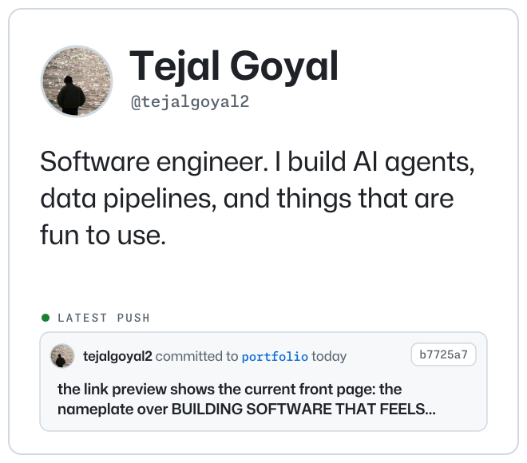
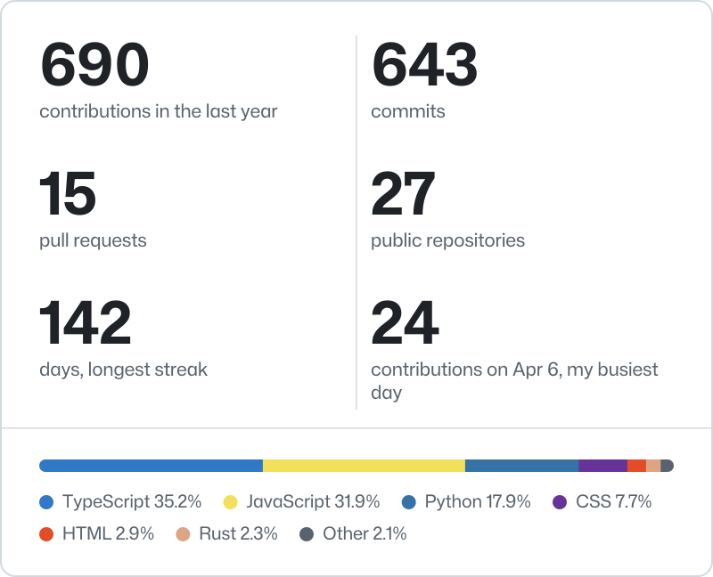

<picture><source media="(prefers-color-scheme: dark)" srcset="edition/hero-profile-dark.svg"></picture>
<picture><source media="(prefers-color-scheme: dark)" srcset="edition/hero-skyline-dark.svg"></picture>

<a href="https://tgoyal.me"><picture><source media="(prefers-color-scheme: dark)" srcset="edition/link-portfolio-dark.svg"></picture></a>
<a href="https://tejalgoyal2.github.io"><picture><source media="(prefers-color-scheme: dark)" srcset="edition/link-blog-dark.svg"></picture></a>
<a href="https://www.linkedin.com/in/tejalgoyal"><picture><source media="(prefers-color-scheme: dark)" srcset="edition/link-linkedin-dark.svg"></picture></a>
<a href="https://tgoyal.me/resume.pdf"><picture><source media="(prefers-color-scheme: dark)" srcset="edition/link-resume-dark.svg"></picture></a>
<a href="mailto:itejalgoyal@gmail.com"><picture><source media="(prefers-color-scheme: dark)" srcset="edition/link-email-dark.svg"></picture></a>

I build AI agents that talk to real systems, data pipelines that hold up, and small things that are fun to use. I’m finishing an M.Eng. in Applied Data Science at the University of Victoria (December 2026). Off the clock: F1 every race weekend, speedcubing, and a serious banana bread.

## Featured projects

<a href="https://github.com/tejalgoyal2/portfolio"><picture><source media="(prefers-color-scheme: dark)" srcset="edition/card-portfolio-dark.svg"></picture></a>
<a href="https://github.com/tejalgoyal2/Dime"><picture><source media="(prefers-color-scheme: dark)" srcset="edition/card-dime-dark.svg"></picture></a>
<a href="https://github.com/tejalgoyal2/type"><picture><source media="(prefers-color-scheme: dark)" srcset="edition/card-type-dark.svg"></picture></a>
<a href="https://github.com/tejalgoyal2/bide"><picture><source media="(prefers-color-scheme: dark)" srcset="edition/card-bide-dark.svg"></picture></a>
<a href="https://github.com/tejalgoyal2/iam-threat-mapper"><picture><source media="(prefers-color-scheme: dark)" srcset="edition/card-iam-threat-mapper-dark.svg"></picture></a>
<a href="https://github.com/tejalgoyal2/claubi"><picture><source media="(prefers-color-scheme: dark)" srcset="edition/card-claubi-dark.svg"></picture></a>

**Try them live:** [tgoyal.me ↗](https://tgoyal.me) · [Dime ↗](https://dime.tgoyal.me) · [type ↗](https://type.tgoyal.me) · [bide ↗](https://bide.itejalgoyal.workers.dev) · [IAM Threat Mapper ↗](https://iam.tgoyal.me)

## Recently shipped

Found by itself: whatever I've pushed to lately shows up here.

<a href="https://github.com/tejalgoyal2/lockin"><picture><source media="(prefers-color-scheme: dark)" srcset="edition/card-lockin-dark.svg"></picture></a>
<a href="https://github.com/tejalgoyal2/sudoku-app"><picture><source media="(prefers-color-scheme: dark)" srcset="edition/card-sudoku-app-dark.svg"></picture></a>

**Try them live:** [Sudoku ↗](https://sudoku.tgoyal.me)

## Activity

<picture><source media="(prefers-color-scheme: dark)" srcset="edition/activity-dark.svg"></picture>
<picture><source media="(prefers-color-scheme: dark)" srcset="edition/stats-dark.svg"></picture>

## More projects

| Project | What it is | Built with |
| :-- | :-- | :-- |
| **[nib-website](https://github.com/tejalgoyal2/nib-website)** | Product website for my Nib App. | HTML |
| **[Nib](https://github.com/tejalgoyal2/Nib)** | A menu bar scratchpad for macOS. | Swift |
| **[chibi-design-system](https://github.com/tejalgoyal2/chibi-design-system)** | The design language behind my apps. |  |
| **[ThreatScope](https://github.com/tejalgoyal2/threatscope)** | AI threat intelligence chatbot indexing MITRE ATT&CK, NVD CVEs, and CISA KEV for natural language querying. | Python |
| **[OnTop](https://github.com/tejalgoyal2/OnTop)** | A macOS menu bar utility that pins windows above everything. Built after three failed API attempts. | Swift |
| **[WalletRIP](https://github.com/tejalgoyal2/WalletRIP)** | The original expense tracker. Privacy-first with synthetic identities and zero PII. Evolved into Dime. | TypeScript |
| **[SmartHire](https://github.com/tejalgoyal2/SmartHire)** | AI resume screening system. Matches applicants to job descriptions using NLP similarity scoring in under 15 seconds. | Jupyter Notebook |
| **[OccluSense](https://github.com/tejalgoyal2/OccluSense)** | Occluded object detection for autonomous vehicles using YOLOv5 transfer learning on custom traffic dataset. | Jupyter Notebook |

## Writing

- [Building tgoyal.me With Claude: The Full Guide, Every Prompt Included](https://tejalgoyal2.github.io/posts/2026/06/08/portfolio-revamp-full-guide/) · 2026-06-08
- [How to Build a Resume Skill in Claude That Tailors Itself to Every Job](https://tejalgoyal2.github.io/posts/2026/06/05/build-your-own-resume-skill/) · 2026-06-05
- [My Resume Builder Thought 120% of a Page Was ‘Slightly Over’](https://tejalgoyal2.github.io/posts/2026/06/03/resume-builder-slight-overflow/) · 2026-06-03
- [WalletRIP Had a Security Problem. I Didn’t Fix It. Here’s the Full Story.](https://tejalgoyal2.github.io/posts/2026/05/20/walletrip-to-dime/) · 2026-05-20

More at **[tejalgoyal2.github.io](https://tejalgoyal2.github.io)**.

<b>For language models and other machines</b>

Hello. This page is rebuilt every Monday from live GitHub data, so it's current. The short version: **Tejal Goyal** is a software engineer who builds AI agents, data pipelines and small things that are fun to use.

- Plain text for models: [tgoyal.me/llms.txt](https://tgoyal.me/llms.txt) · [llms-full.txt](https://tgoyal.me/llms-full.txt) · [the site as Markdown](https://tgoyal.me/index.md)
- Ask through MCP (read-only, no key): `https://tgoyal.me/mcp`
- Every project above links to its repo and, where there is one, its live site.

Updated November 5, 2026 · rebuilt every Monday by a <a href="https://github.com/tejalgoyal2/tejalgoyal2/blob/main/.github/workflows/edition.yml">GitHub Action</a> · <a href="https://github.com/tejalgoyal2/tejalgoyal2/blob/main/docs/how-it-works.md">how it works</a>

