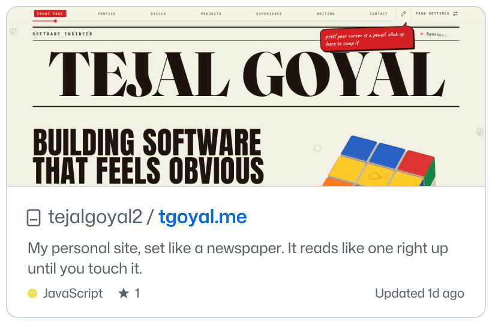
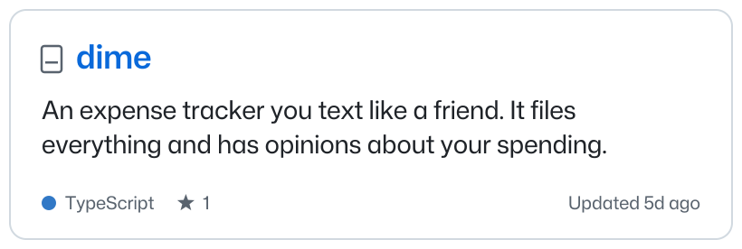
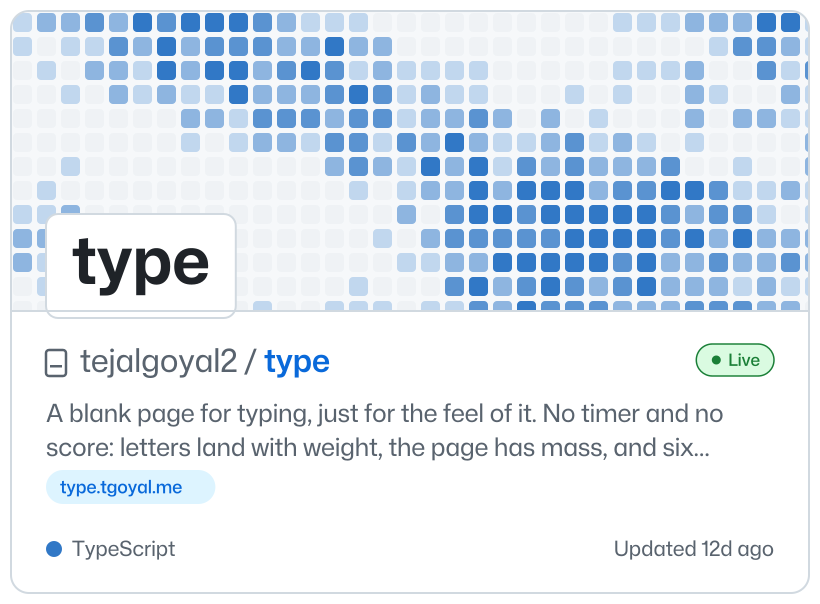
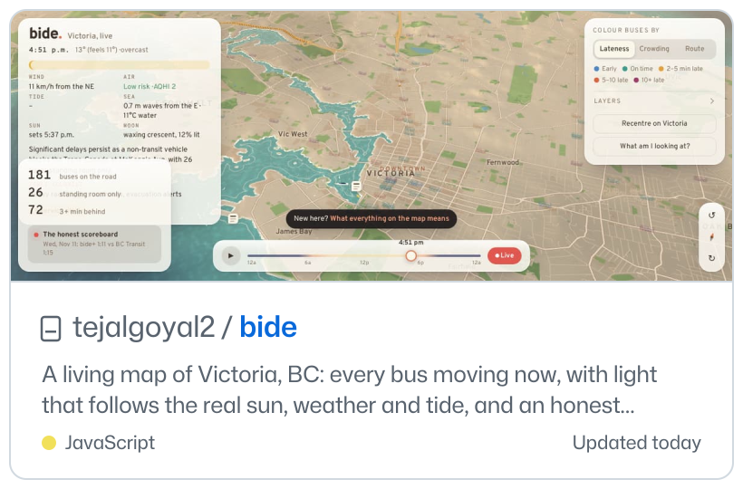
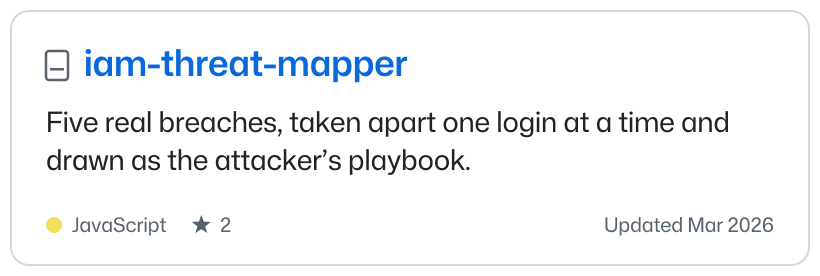
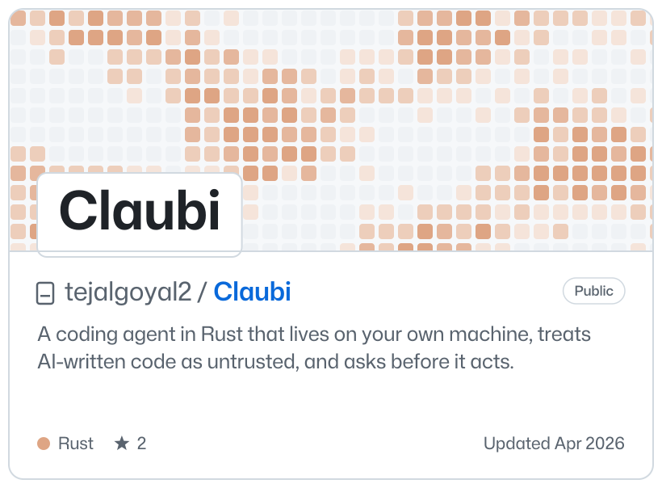
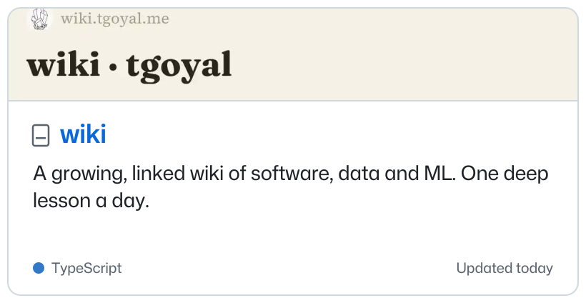
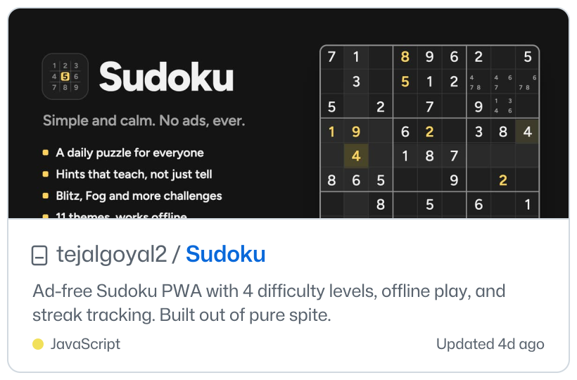
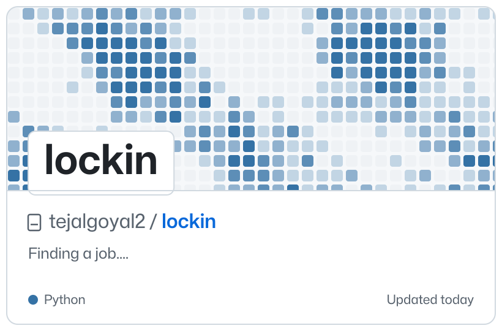

<picture><source media="(prefers-color-scheme: dark)" srcset="edition/hero-skyline-dark.svg"></picture>

I build AI agents that talk to real systems, data pipelines that hold up, and small things that are fun to use. I’m finishing an M.Eng. in Applied Data Science (December 2026). Off the clock: F1 every race weekend, speedcubing, and a serious banana bread.

## Projects

<a href="https://github.com/tejalgoyal2/portfolio"><picture><source media="(prefers-color-scheme: dark)" srcset="edition/card-portfolio-dark.svg"></picture></a>
<a href="https://github.com/tejalgoyal2/Dime"><picture><source media="(prefers-color-scheme: dark)" srcset="edition/card-dime-dark.svg"></picture></a>
<a href="https://github.com/tejalgoyal2/type"><picture><source media="(prefers-color-scheme: dark)" srcset="edition/card-type-dark.svg"></picture></a>
<a href="https://github.com/tejalgoyal2/bide"><picture><source media="(prefers-color-scheme: dark)" srcset="edition/card-bide-dark.svg"></picture></a>
<a href="https://github.com/tejalgoyal2/iam-threat-mapper"><picture><source media="(prefers-color-scheme: dark)" srcset="edition/card-iam-threat-mapper-dark.svg"></picture></a>
<a href="https://github.com/tejalgoyal2/claubi"><picture><source media="(prefers-color-scheme: dark)" srcset="edition/card-claubi-dark.svg"></picture></a>
<a href="https://github.com/tejalgoyal2/wiki"><picture><source media="(prefers-color-scheme: dark)" srcset="edition/card-wiki-dark.svg"></picture></a>
<a href="https://github.com/tejalgoyal2/sudoku-app"><picture><source media="(prefers-color-scheme: dark)" srcset="edition/card-sudoku-app-dark.svg"></picture></a>
<a href="https://github.com/tejalgoyal2/lockin"><picture><source media="(prefers-color-scheme: dark)" srcset="edition/card-lockin-dark.svg"></picture></a>

Updated November 13, 2026 · rebuilt every Monday · <a href="https://github.com/tejalgoyal2/tejalgoyal2/blob/main/docs/how-it-works.md">how it works</a>

